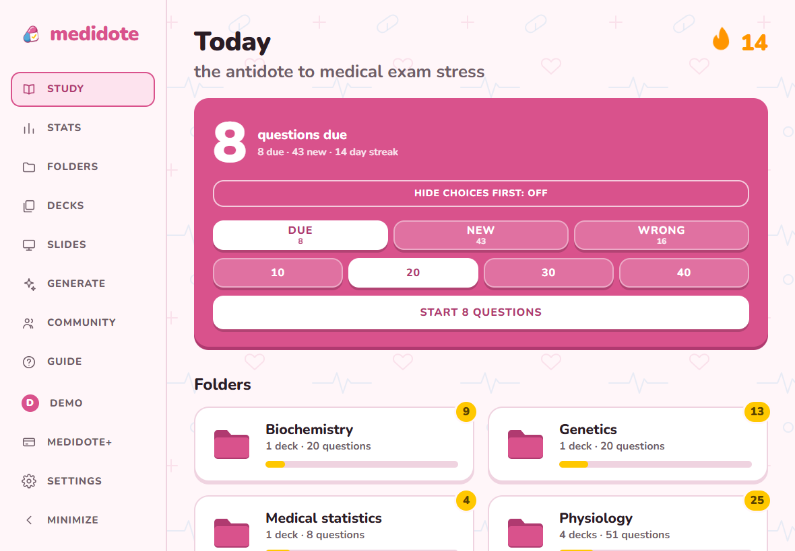
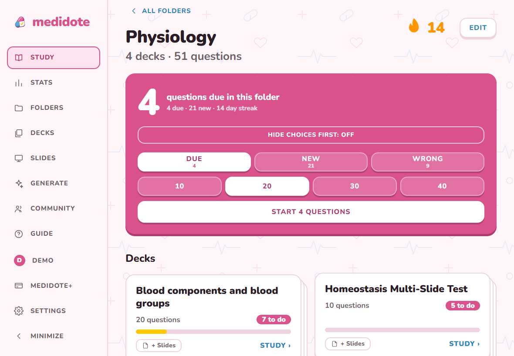
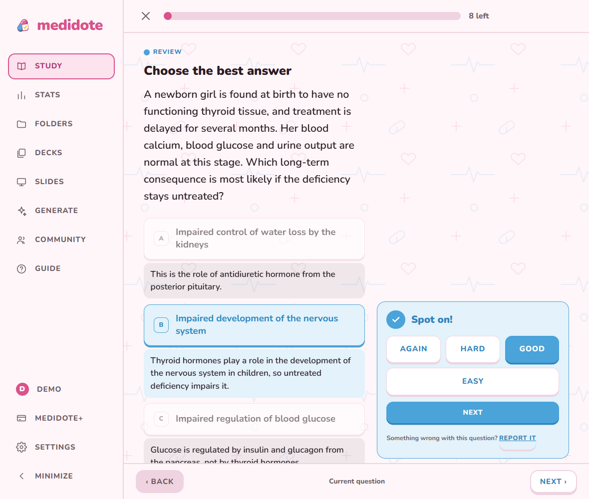
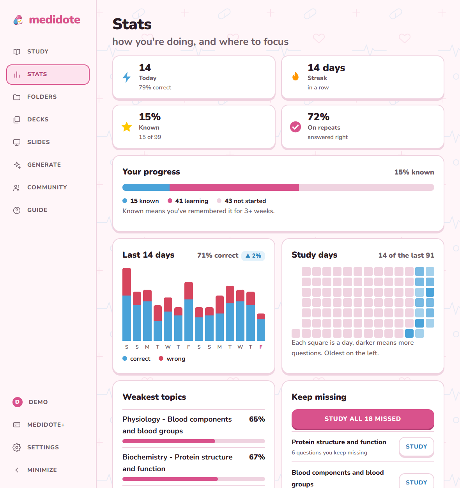
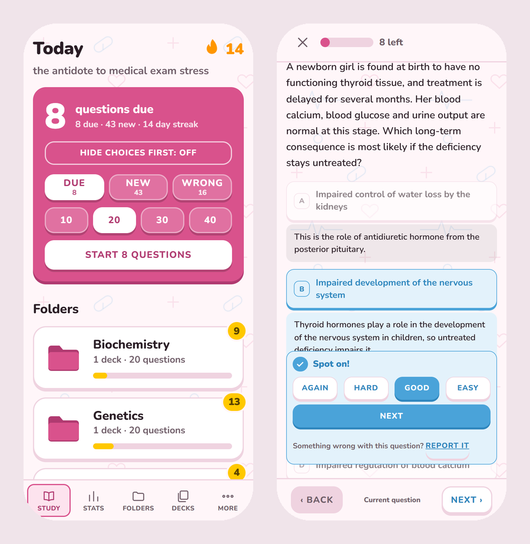
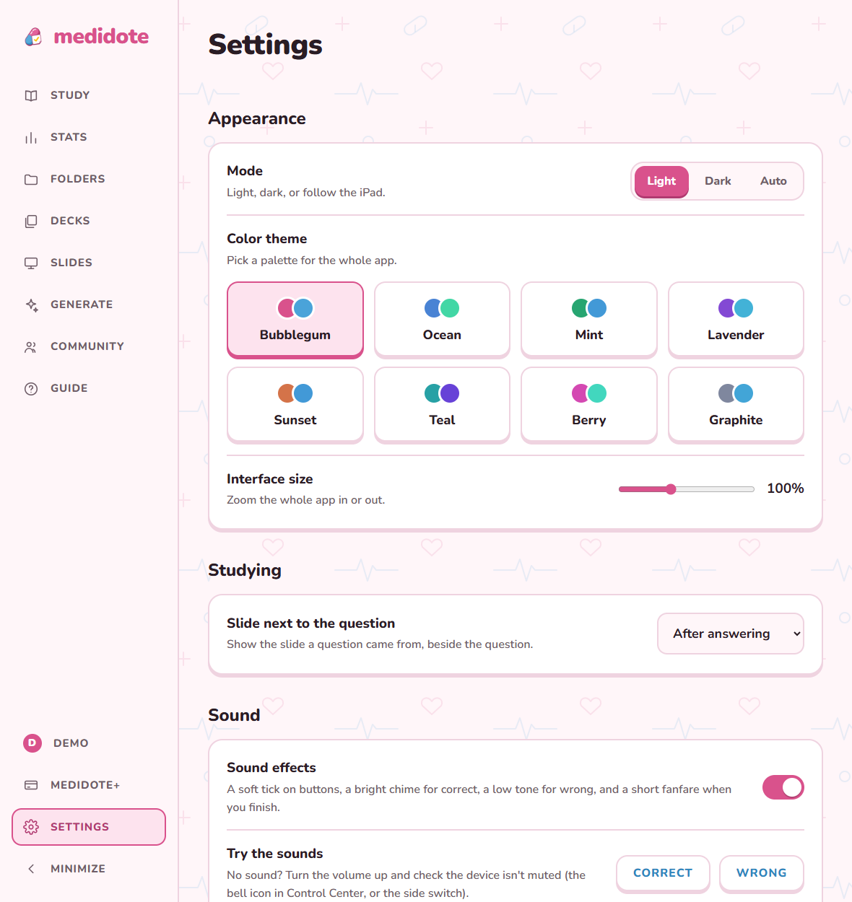

# medidote

**The antidote to medical exam stress.**

medidote turns your own lecture slides into exam-style multiple-choice questions, then uses spaced repetition so you actually remember them. Upload the slides, let the AI write the questions, and study the ones you keep getting wrong until they stick.

  

## Why I built it

I built this for my sister, who is a medical student. She was using a question bank for her exams and wanted the same thing for her *own* lectures: questions written from the slides she is actually being taught, with the questions she keeps getting wrong coming back until they stick.

## What it does

### Questions from your own slides

Upload your lecture PDFs, pick the slides, the deck and how many questions you want, and the AI writes single-best-answer questions from them. Questions are case-based and exam-level, every option comes with an explanation, and each question points back to the slide it came from. Questions are reviewed against a written quality rubric, and you can report any that look wrong.

You can also import a deck of questions from a file, or write your own.

### Slides next to your questions

Slides live in your account, organised by deck and folder, as tiles or a list. While you study, the slide a question came from can sit beside the question or appear after you answer, so you learn from the source and not only the answer.

  

### Spaced repetition that follows how you do

Pick an answer and get instant feedback with an explanation. Say how it felt (Again, Hard, Good or Easy) and the next review is scheduled to match: the better you know a question, the longer until you see it again. Study what is due, what is new, or only the questions you got wrong, in sessions of 10 to 40. "Hide choices first" lets you answer from memory before the options appear.

  

### See what to focus on

The Stats page shows how much you know, how the last two weeks went, your study days, your weakest topics, the questions you keep missing, and how many reviews are coming up.

  

### Folders and decks

Keep things tidy with one folder per subject and one deck per lecture. Folders and decks can be renamed or deleted whenever you like, and folders can have their own colour.

### Works on any device

medidote is a web app you add to your home screen, so it opens full screen like a normal app. It adapts to the screen: a sidebar on iPad and desktop, a tab bar on iPhone. Your account keeps your decks, progress and slides in sync across devices.

  

### Make it yours

Eight colour themes, light and dark mode, adjustable interface size and optional sound effects, all in Settings.

  

### Accounts and privacy

Sign in with Google or an email link. New accounts get a free period to try the AI question writing, and creating, importing and studying decks stays free. You can delete your account and all of its data from Settings. See the [Terms of Use](legal/terms.html) and [Privacy Policy](legal/privacy.html).

medidote is a study aid, not medical advice. AI-written questions can be wrong, so check them against your course material.

## License

Copyright (c) 2026 Malak Elsadek. All rights reserved. This is proprietary software: you may not copy, modify, host, redistribute or use it without written permission. See [LICENSE](LICENSE).
